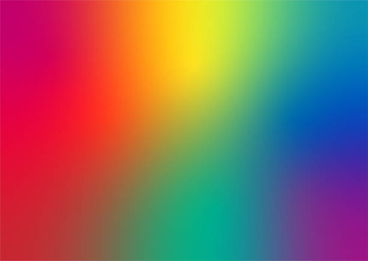
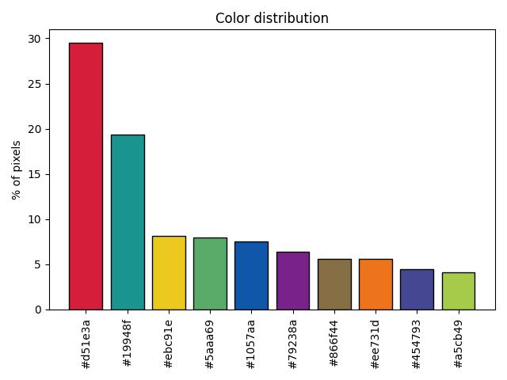

# GlowByte

A Python image composition engine with layers, filters and blend modes — **work in progress**.

The goal: edit images with code instead of Photoshop. A canvas holds layers, each layer has its own position, opacity, blend mode and filters, and GlowByte composites everything into one image. The layer engine isn't built yet. I'm starting with color analysis, which later features (palettes, color overlays, gradient maps) will build on.

## What works now

### Color palette detection — `prelim/colors.py`

Finds the main colors of an image and plots how much of the image each one covers.

- Measures color similarity as Euclidean distance in RGB space
- Merges similar colors based on a sensitivity from 0–100 (higher = more distinct colors)
- Outputs a histogram of the resulting palette with percentages

| Input | Output |
|---|---|
|  |  |

```
cd prelim
python colors.py rainbow_gradient.jpg
```

Images are read from `prelim/input/` and written to `prelim/output/`. You'll be asked for a sensitivity (press Enter for the default of 85).

### Region growing — `prelim/region_grow.py` *(in progress)*

Uses the detected palette to repaint the image: it places a seed pixel for each palette color and grows regions out to neighbouring pixels within a tolerance. Seed detection is done; region growing and gap filling are next.

## Requirements

Python 3, `numpy`, `Pillow`, `matplotlib`

```
pip install numpy pillow matplotlib
```

## Next steps

- [ ] Finish region growing and save the recolored image
- [ ] Pixel art mode: turn an image (with optional text) into pixel art using the detected palette
- [ ] Edge detection (e.g. Sobel filter)
- [ ] Canvas and layer system
- [ ] Blend modes and basic filters

## License

MIT
